 

<table align="center">
  <tr>
    <td width="44%" valign="top"></td>
    <td width="56%" valign="top"></td>
  </tr>
</table>

## 🤖 What I do

I build **Physical AI systems**: simulated twins of real robots (quadrupeds and humanoids) and the perception, navigation and voice/vision agents that run on them, from NVIDIA Isaac Sim to real hardware.

- 🧪 Digital twins of **Unitree Go2, G1 and H1** in Isaac Sim, bridged to the real robots
- 👁️ AI-powered **industrial inspection** with synthetic data and detector training
- 🗣️ Voice + vision agents on a real **Unitree G1**
- 🚚 Multi-robot fleets: AMRs, quadrupeds and humanoids working together

## 🛠️ Stack

**Robotics & simulation**

  
  
  
  

**AI & vision**

  
  
  

**Languages**

  
  

**Tooling**

  
  
  
  

## 🚀 Featured projects

<!-- TODO: replace each "#" with the repo link, then drop a GIF into assets/ and uncomment its  line -->
<table>
  <tr>
    <td width="50%" valign="top">
      <a href="https://github.com/vedsom/Multi_Agent_Physical_AI_Fleet_Twin"><b>Multi-Agent Physical AI Fleet Twin</b></a> 
      Digital twins of a mixed robot fleet (AMR, Go2, G1) in Isaac Sim. 
      <code>Isaac Sim</code> · <code>Python</code> · <code>ROS</code>
      <!--   -->
    </td>
    <td width="50%" valign="top">
      <a href="#"><b>Unitree Go2 Digital Twin</b></a> 
      Bidirectional twin of the Go2 EDU in Isaac Sim with a UDP/TCP socket bridge and navigation. 
      <code>Isaac Sim</code> · <code>Sockets</code> · <code>Navigation</code>
      <!--   -->
    </td>
  </tr>
  <tr>
    <td width="50%" valign="top">
      <a href="#"><b>G1 Voice Guidance Agent</b></a> 
      Voice-driven SOP repair guidance, vision Q&amp;A, follow mode and gestures on a real G1. 
      <code>Parakeet</code> · <code>Nemotron</code> · <code>Cosmos</code>
      <!--   -->
    </td>
    <td width="50%" valign="top">
      <a href="#"><b>Vision Inspection Cell</b></a> 
      Conveyor, cameras and an arm that rejects defects; Replicator synthetic data and detector training. 
      <code>Replicator</code> · <code>Synthetic data</code> · <code>Detection</code>
      <!--   -->
    </td>
  </tr>
  <tr>
    <td width="50%" valign="top">
      <a href="#"><b>Autonomous AMR Digital Twin</b></a> 
      ROS odometry streamed over UDP into an Isaac Sim twin of an autonomous mobile robot. 
      <code>ROS</code> · <code>UDP</code> · <code>Isaac Sim</code>
      <!--   -->
    </td>
    <td width="50%" valign="top">
      <a href="#"><b>G1 → AMR Toolbox Handover</b></a> 
      A Unitree G1 picks up a toolbox and places it onto an AMR in Isaac Sim, driven by GR00T. 
      <code>GR00T</code> · <code>Isaac Sim</code> · <code>Manipulation</code>
      <!--   -->
    </td>
  </tr>
</table>

## 🐍 Contribution snake

<!-- Appears after the "Generate contribution snake" workflow has run once. Delete this section to skip it. -->
<picture>
  <source media="(prefers-color-scheme: dark)" srcset="https://raw.githubusercontent.com/vedsom/vedsom/output/github-snake-dark.svg"/>
  
</picture>

## 📫 Connect

