### `01` &nbsp;What I build

I build **Physical AI systems**: digital twins of real robots, quadrupeds and humanoids, plus the perception, navigation and voice/vision agents that run on them, from **NVIDIA Isaac Sim** to real hardware.

- **Digital twins** of the Unitree Go2, Unitree G1 and UR5 arm in Isaac Sim, bridged live to the real robots
- **Autonomous navigation** on the Go2: LiDAR mapping, waypoint graphs and A* planning
- **Voice + vision agents** on a real Unitree G1 with NVIDIA open models
- **Multi-robot fleets**: AMRs, quadrupeds and humanoids working one job together
- **AI industrial inspection** with synthetic data and detector training

### `02` &nbsp;Featured projects

<b>Also in the lab:</b> vision inspection cell with Replicator synthetic data · G1 → AMR toolbox handover driven by GR00T

### `03` &nbsp;Stack

 

### `04` &nbsp;Connect

